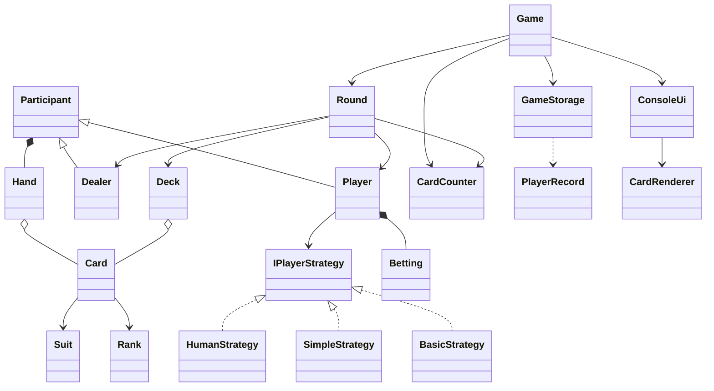

# Tjugoett

Tjugoett (blackjack) som konsolspel i C#. Kunskapskontroll 3, MAI26MA.

## Starta

```bash
dotnet run
```

Kräver .NET 10.

## Funktioner

- 1–5 spelare: människa eller dator (enkel strategi eller grundstrategi)
- Givaren köper på 16 eller lägre och stannar på 17
- Statistik (vinster, förluster, lika) sparas i `players.txt` mellan körningar
- Tillval: sko med 6 kortlekar, skiljekort och korträkning (Hi-Lo)
- Tillval: satsningar med marker
- Korten ritas som bilder i konsolen

## Klassdiagram 



## Designval

- Bara `ConsoleUi` använder `Console`. Övriga klasser räknar och returnerar svar.
- `Participant` är en abstrakt basklass för `Player` och `Dealer`, som båda har namn och hand.
- Spelarens beslut ligger i `IPlayerStrategy`, så människa och dator kan bytas utan att `Player` ändras.
- `GameStorage` kraschar inte om filen saknas eller är trasig: trasiga rader hoppas över, och `Save` returnerar `true` eller `false`.
- Korträknaren ser bara kort som syns. Givarens hålkort räknas först när det vänds.

## Gruppen

| Namn | GitHub | Ansvar |
| --- | --- | --- |
| Mohammed | Modi388 | Card, Suit, Rank, Deck, GameStorage, korträkning |
| Abdimajid | AbdimajidJele | Hand, Participant, Dealer, datorstrategier |
| Yassin | Yassin22x | Round, Outcome, Move, Betting |
| Abodi | floraiku | ConsoleUi, CardRenderer, Game |